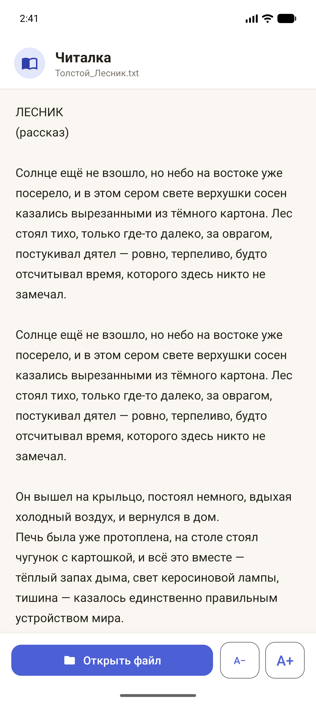
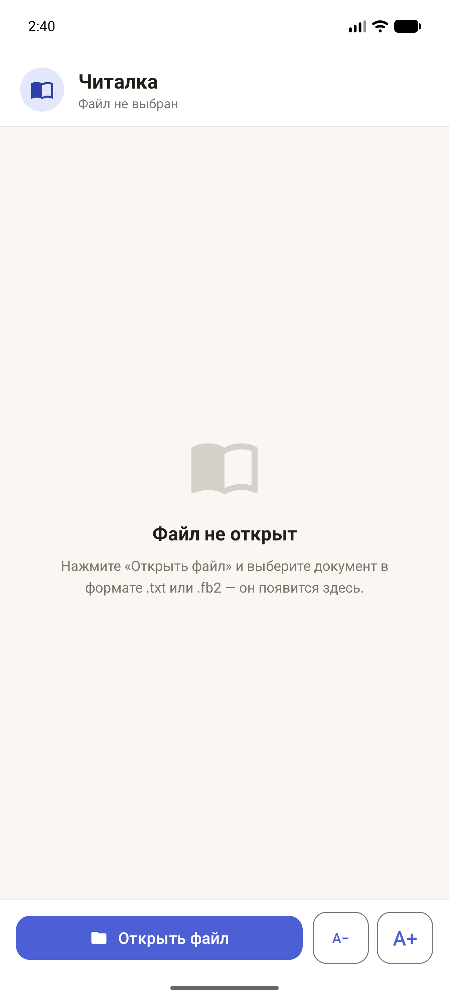
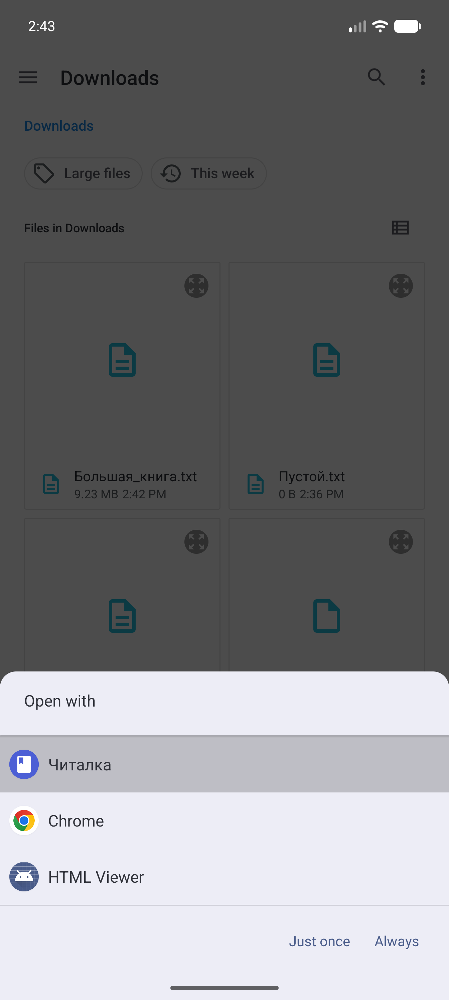
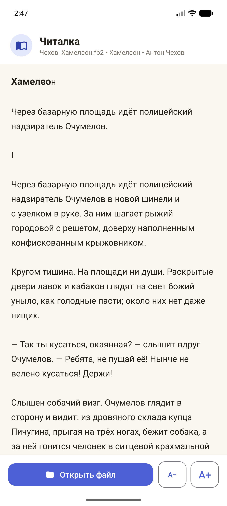
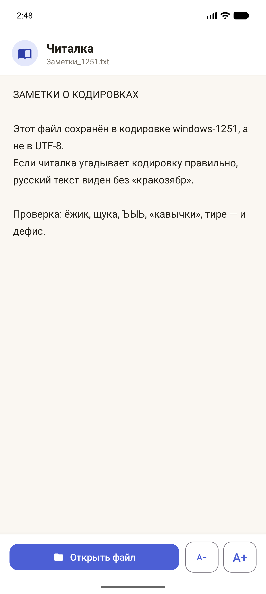
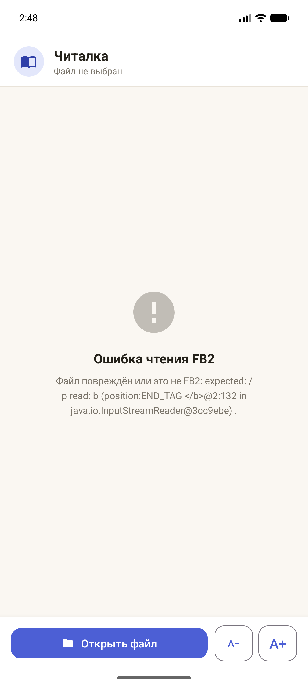
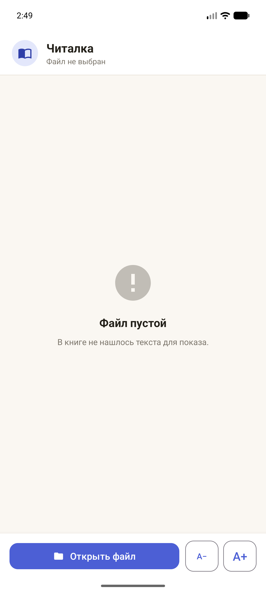
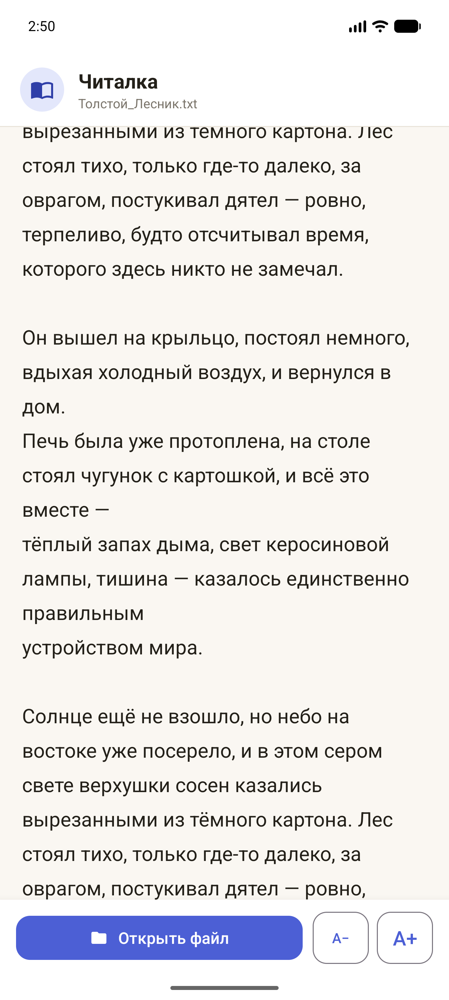
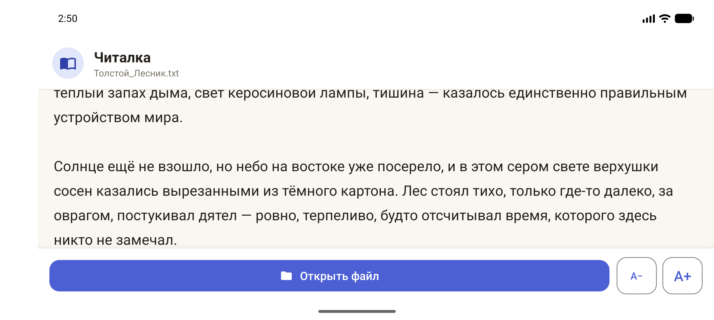
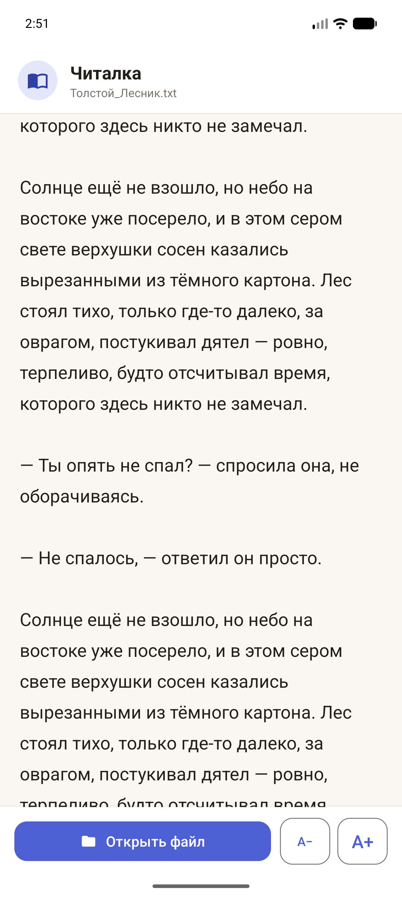

# Читалка — Android-приложение для чтения .txt и .fb2

Учебный проект: приложение открывает текстовый файл или книгу FictionBook и показывает
содержимое на экране с вертикальной прокруткой.

**Стек:** Kotlin · Material 3 · ViewBinding · minSdk 24 · targetSdk 36 · без сторонних библиотек
(только AndroidX и Material Components).

<p align="center">
  
</p>

---

## Возможности

- **Кнопка «Открыть файл»** — системный диалог выбора документа (`ActivityResultContracts.OpenDocument`),
  поэтому приложению не нужны разрешения на доступ к памяти.
- **Индикатор загрузки** — файл читается в фоновом потоке, поверх области чтения показывается
  `ProgressBar` с подписью «Чтение файла…», кнопка на это время блокируется. Индикатор держится
  минимум 300 мс, чтобы не мигать на маленьких файлах.
- **Прокрутка и шрифт** — `ScrollView` + `TextView`, размер шрифта регулируется кнопками **A− / A+**
  (12…30 sp) и запоминается между запусками.
- **Обработка ошибок** — отдельные экраны для пустого файла, повреждённого FB2, отсутствия доступа,
  слишком большого файла (> 25 МБ) и потерянного файла. Приложение не падает.
- **Поддержка FB2** — собственный потоковый парсер на `XmlPullParser`.
- **Автоопределение кодировки** — UTF-8 / UTF-16 по BOM, иначе проверка «строгим» UTF-8,
  а если не сходится — windows-1251 (частый случай для старых русских .txt).
- **Продолжение чтения** — при повторном запуске открывается последний файл на том же месте.
- **«Открыть с помощью → Читалка»** для .txt и .fb2 из файловых менеджеров.
- Корректная работа на Android 15/16 (обработка системных отступов), поворот экрана не сбрасывает текст.

---

## Соответствие заданию

| Требование | Реализация |
|---|---|
| Кнопка «Открыть файл» | `MaterialButton` в нижней панели → системный выбор документа |
| Индикатор загрузки, пока файл читается | фоновое чтение в `ExecutorService` + `ProgressBar` с подписью, блокировка кнопки |
| Область отображения текста с вертикальной прокруткой | `ScrollView` + `TextView`, поля 22 dp, межстрочный интервал 1.45 |
| Обработка ошибок (пустой файл, ошибка чтения) | `ReadException` с человеческим заголовком и пояснением, отдельные состояния экрана |
| Поддержка формата FB2 | `Fb2Parser` на `XmlPullParser`: текст из `<body>`, пропуск `<binary>`, жирные заголовки глав |

---

## Скриншоты

| Пустой экран | Индикатор загрузки |
|---|---|
|  |  |

| Чтение .txt | Книга .fb2 |
|---|---|
|  |  |

| Кодировка windows-1251 | Ошибка разбора FB2 |
|---|---|
|  |  |

| FB2 без текста | Крупный шрифт и прокрутка |
|---|---|
|  |  |

| Ландшафтная ориентация | Продолжение с сохранённого места |
|---|---|
|  |  |

---

## Как собрать

> ⚠️ **Важно:** папку проекта нельзя держать в пути с кириллицей
> (`C:\Users\...\Рабочий стол\Читалка`). Сборщик Android на Windows падает с ошибкой
> «Your project path contains non-ASCII characters».

### Android Studio
1. `File → Open` → выбрать папку проекта.
2. Дождаться синхронизации Gradle.
3. `Run ▶` на устройстве или эмуляторе.

### Командная строка
```bash
./gradlew assembleDebug
# готовый APK: app/build/outputs/apk/debug/app-debug.apk
```

Установить на устройство:
```bash
adb install -r APK/Reader-debug.apk
```

Собранный APK уже лежит в папке [`APK`](APK).

---

## Тестовые файлы

В папке [`testdata`](testdata) лежат документы для проверки всех сценариев:

| Файл | Что проверяет |
|---|---|
| `sample_utf8.txt` | обычный UTF-8 текст, прокрутка, изменение шрифта |
| `sample_cp1251.txt` | автоопределение windows-1251 — текст без «кракозябр» |
| `sample.fb2` | разбор FB2: название и автор в шапке, главы жирным, абзацы с пустой строкой |
| `empty.txt` | ошибка «Файл пустой» |
| `broken.fb2` | ошибка «Ошибка чтения FB2» (несовпадающие теги) |
| `no_text.fb2` | FB2 без текста → «Файл пустой» |

Для проверки индикатора загрузки подойдёт любой большой .txt (несколько мегабайт) —
в репозиторий такой файл не добавлен.

---

## Структура проекта

```
app/src/main/java/com/example/reader/
├── MainActivity.kt    — экран, выбор файла, состояния «загрузка / текст / ошибка», шрифт, отступы
├── TextLoader.kt      — чтение файла, определение кодировки, тексты ошибок
└── Fb2Parser.kt       — разбор FB2 в текст с форматированием

app/src/main/res/
├── layout/activity_main.xml   — шапка, область чтения, индикатор, нижняя панель
├── drawable/                  — иконки (книга, папка, ошибка)
└── values/                    — строки, цвета, тема Material 3
```

### Как разбирается FB2

Формат — обычный XML, поэтому используется потоковый `XmlPullParser`: файл читается по мере
разбора и в память не попадают base64-картинки из `<binary>`. Из `<description>` берутся
`<book-title>` и имя автора, из `<body>` — текст. Названия глав помечаются `StyleSpan(BOLD)`
и увеличиваются `RelativeSizeSpan`, абзацы разделяются пустой строкой, строки стихов идут подряд.

---

## Что проверено на эмуляторе (Android 16, API 36)

- запуск приложения, пустое состояние;
- открытие .txt (UTF-8) и .fb2, прокрутка длинного текста;
- индикатор загрузки на файле 9 МБ, блокировка кнопки во время чтения;
- увеличение/уменьшение шрифта, сохранение размера после перезапуска;
- пустой файл, повреждённый FB2, FB2 без текста — понятные сообщения, без падений;
- windows-1251 — русский текст читается корректно;
- поворот экрана — содержимое и позиция сохраняются;
- перезапуск приложения — последний файл открывается сам на сохранённом месте.

Падений и ANR в логах нет.
